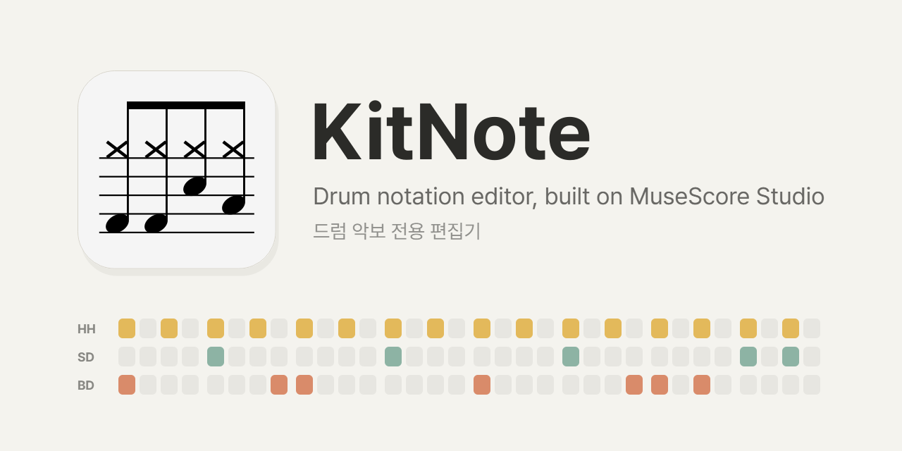
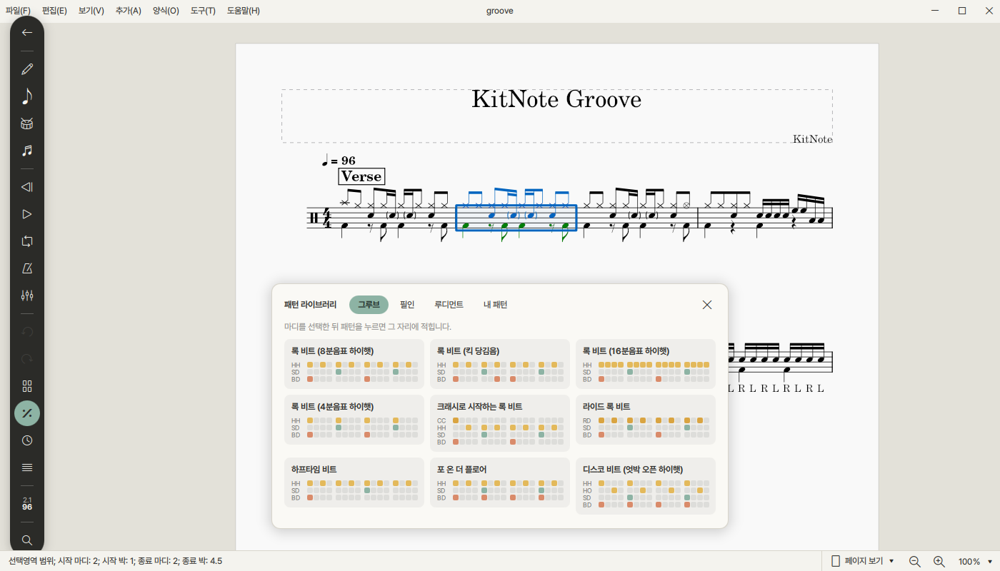
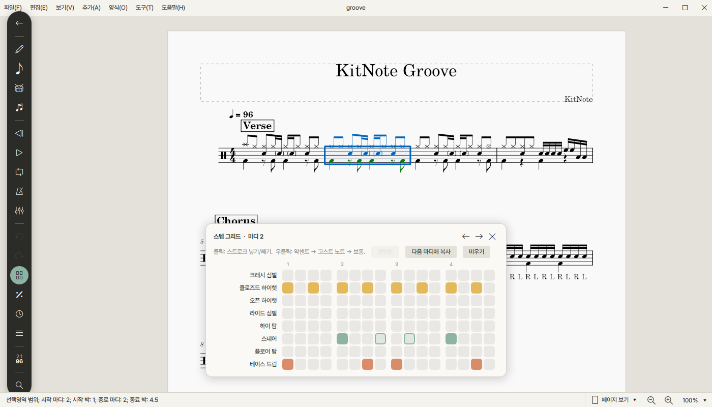

<p align="center"></p>

<p align="center"><b>English</b> · <a href="README.ko.md">한국어</a></p>

# KitNote

KitNote is a **drum notation editor** for drummers. It is built on the source code of
[MuseScore Studio](https://github.com/musescore/MuseScore) 4.7.5 and keeps its engraving, playback and editing, but
everything around them is made for the drum kit: drum-only templates, palettes and pads, a step grid, a pattern library,
drum-aware playback, a drum score made from a recording, and a local MCP server so AI tools such as Claude Code and Codex
can write and transcribe drum charts for you.



## Features

**Writing**
- **Step grid** — write a measure like on a drum machine, sixteenth by sixteenth.
- **Pattern library** — grooves, fills and rudiments shown as mini grids; click to insert. Save your own measures as patterns, or ask for a random fill.
- **Drum patterns** (`Add → Drum patterns`) — 20 grooves and fills (rock, Motown, shuffle, jazz ride, disco, bossa nova, reggae, 6/8) written into the selected measures.
- **Rudiments** (`Add → Rudiments`) — nine snare rudiments with sticking, flams and accents.
- **Drum tab in and out** — copy a score as text tab (`HH|x-x-x-x-|`), or paste a text drum tab from the web and get notation.
- **Selection tools** — hi-hat ↔ ride, swap sticking, accents on or off the beat, sticking (R L R L) and counting (1 e & a) under the notes.

**Reading and playing**
- **Published-chart engraving by default** — four measures to a line, boxed section letters, `%` repeat signs for 1, 2 and 4 measures with counts, merged rests for hands and feet.
- **Drum key** — a legend of the drums the score uses, before the first measure.
- **Drum-aware playback** — soft ghost notes, light flam grace notes, an `o` over the hi-hat plays the open hi-hat, one-click swing.
- **Practice** — loop a passage with a rising tempo, tap tempo, song structure (Intro, Verse, Chorus …) to jump between sections.
- **Play along with the recording** — a score made from a recording keeps it: the Mixer gets a *Recording* row, and playback follows the recording's own timing measure by measure while the chart shows one clean tempo.

**Drum score from a recording** (`File`, or drop the recording on the window)
- The drums are separated from the song, the beat and the measures found, and the strokes recognised by **KitNote's own drum model**, trained only on openly licensed data (real drummers' performances and grooves of many styles played on 51 openly licensed sampled kits).
- Open or closed hi-hat, crash or ride, which tom, ghost notes, the time signature (4/4, 3/4, 6/8, 12/8) and the sections are decided for you; repeated measures become `%` signs.
- The result is a starting point to correct, not a finished transcription. The audio engine (about 1 GB) is downloaded only after you agree.

**AI tools** (`Edit → Preferences → AI`)
- One click sets up KitNote's local MCP server (`kitnote-mcp.exe`) and skill in Claude Code, Codex, Claude Desktop, Cursor or Gemini CLI.
- Then ask in plain words, for example:
  - *"Make a drum chart in KitNote: pop rock at 120 BPM, intro 4, verse 8, chorus 8 on the ride, a fill at the end of each section. PDF and MIDI too."*
  - *"In song.kitnote, change measures 9–16 from hi-hat to ride and put a tom fill in the last measure."*
  - *"Make a drum score of C:/Music/song.mp3."*
- Scores are saved as `.kitnote` and can be exported to PDF, PNG, SVG, MIDI, MusicXML, MP3/WAV/OGG/FLAC and text tab.



## Install

Download from the [Releases](../../releases) page. Every release has a `SHA256SUMS.txt` with the checksum of each file.

### Windows

1. Download `KitNote-<version>-win64.zip` and unpack it.
2. Run `bin\KitNote.exe` directly, or install it for your user (Start menu shortcut, `.kitnote` files open with KitNote, removable from *Installed apps*; no administrator rights needed):

   ```powershell
   powershell -ExecutionPolicy Bypass -File install.ps1
   ```

   The first start shows a Windows SmartScreen warning, because the program is not code-signed yet. Choose *More info*, then *Run anyway*.

### macOS

1. Download the `.dmg` file and open it. KitNote runs on macOS 14.4 or later, on Apple silicon and Intel Macs.
2. Drag **KitNote** into **Applications**.
3. If the first start is blocked (the app is not notarized yet), open *System Settings > Privacy & Security*, scroll down to the message about KitNote and click *Open Anyway*, then confirm. On macOS 14 and older, control-clicking KitNote in Applications and choosing *Open* also works.

The interface is in English and Korean. Scores with pitched instruments are not opened.

## Documentation

- User guide: [English](docs/kitnote/user-guide.en.md) · [한국어](docs/kitnote/user-guide.ko.md) (also under `Help → KitNote user guide`)
- What KitNote changes in MuseScore Studio, and how to build and package it: [KITNOTE.md](KITNOTE.md)
- Building, tests, build-time downloads and retraining the drum model: [CONTRIBUTING.md](CONTRIBUTING.md)
- Third-party components and the data the drum model was trained on: [THIRD_PARTY_NOTICES.md](THIRD_PARTY_NOTICES.md)

## Building from source

Windows with Visual Studio 2022 or later, CMake, Ninja and Qt 6.10 (msvc2022_64). The short version:

```bash
bash ./ninja_build.sh -t install
python tools/kitnote/smoke_test.py
```

The full instructions, including the Qt modules needed, are in [CONTRIBUTING.md](CONTRIBUTING.md).

## Acknowledgements

KitNote stands on [MuseScore Studio](https://musescore.org) and its contributors. Recording transcription uses
[Demucs](https://github.com/facebookresearch/demucs) for separation and [Beat This!](https://github.com/CPJKU/beat_this)
for beats; KitNote's drum model learned from the Groove MIDI Dataset and E-GMD (Google Magenta) and from openly licensed
sampled kits — see [share/ai/kitnote_drums.NOTICE.txt](share/ai/kitnote_drums.NOTICE.txt).

## Licence and trademarks

KitNote is free software under the GNU General Public License v3.0 — see [LICENSE.txt](LICENSE.txt).

MuseScore is a trademark of MuseScore Limited. KitNote is an independent modification of MuseScore Studio 4.7.5 and is
not affiliated with or endorsed by MuseScore Limited or Muse Group. Names such as "MuseScore Studio" and
"MuseScore file (*.mscz)" are used only to refer to the source program and its file format.
